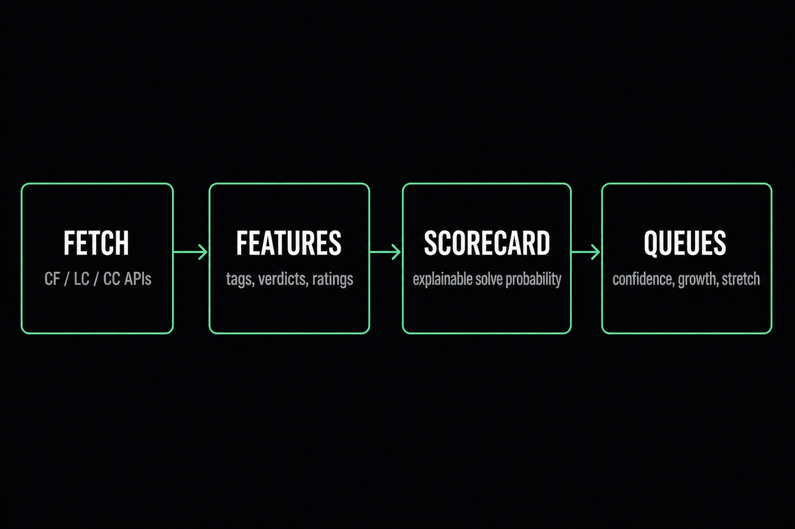
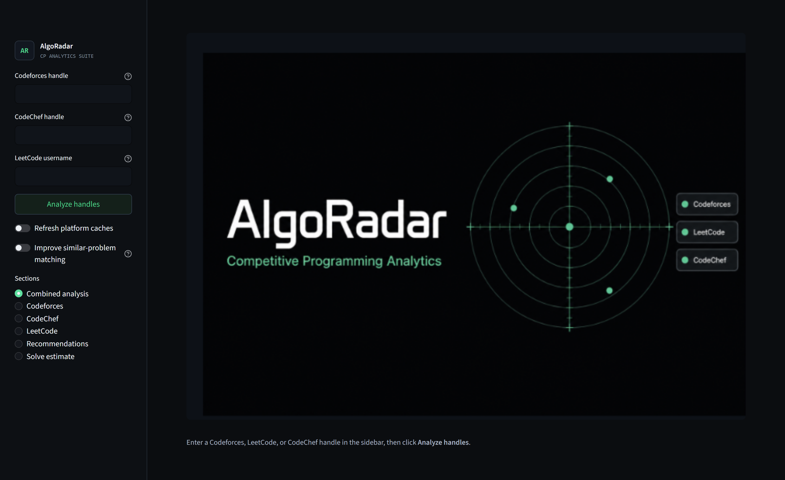
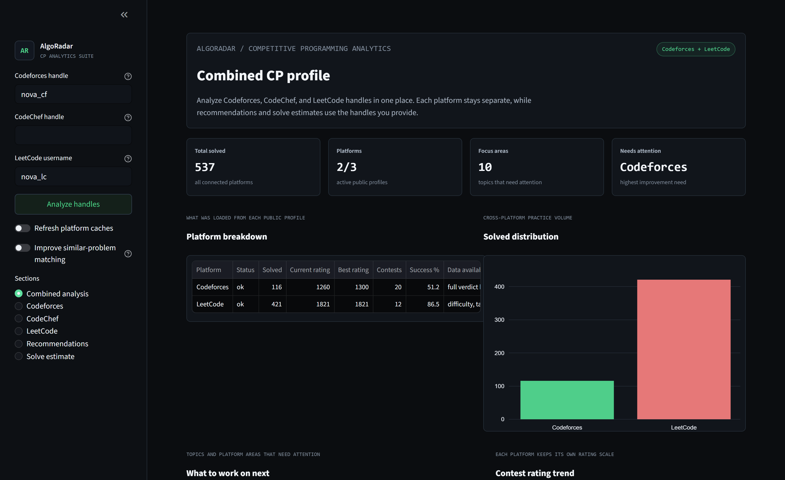
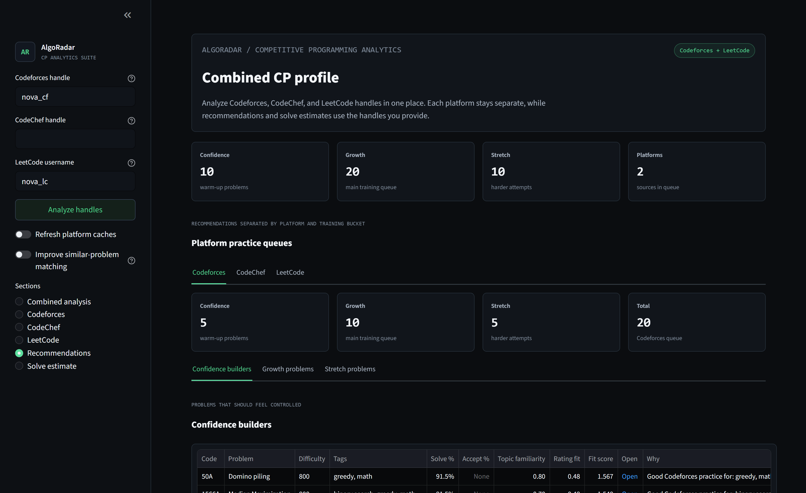
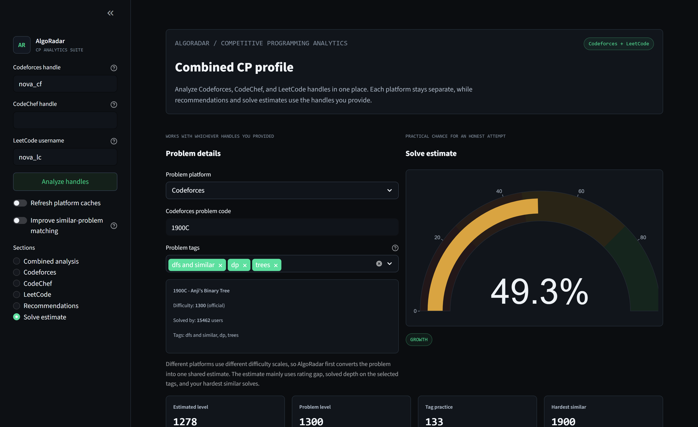

<p align="center">
  
</p>

<p align="center">
  <strong>AlgoRadar</strong> · Cross-platform CP analytics for Codeforces, LeetCode, and CodeChef
</p>

<p align="center">
  <a href="https://algoradar-cp.streamlit.app"></a>
  <a href="https://github.com/Shivampal157/AlgoRadar-CP"></a>
  
  
  
  
</p>

I built AlgoRadar because I practice on **Codeforces**, **LeetCode**, and **CodeChef** at the same time, and none of those sites answer the question I actually care about: *which topics are holding my rating back, and what should I solve next?*

Enter any mix of handles. The app pulls live profile data, scores weak areas with an explainable model, and returns **confidence / growth / stretch** queues plus a solve-probability estimate for a target problem.

**Live demo:** [algoradar-cp.streamlit.app](https://algoradar-cp.streamlit.app)

**Shivam Pal** · IIIT Agartala · [GitHub](https://github.com/Shivampal157) · Codeforces Specialist

<p align="center">
  
</p>

## What it does

- Live **Codeforces** analysis from the official API (submissions, verdicts, tags, contest rating)
- **LeetCode** profile, topics, contest trend, and problem lookup by number, title, slug, or URL
- **CodeChef** rating history and rating-band practice recommendations
- Combined view when two or more platforms are connected
- Explainable **solve-probability scorecard** (not a black-box classifier)
- **Confidence / growth / stretch** recommendation queues per platform
- Optional MiniLM matcher for similar-but-harder problems
- Streamlit dashboard with cached API responses for repeat runs

## Product screens

<p align="center">
  
</p>
<p align="center"><em>Open the app — radar landing, then drop in handles</em></p>

<p align="center">
  
</p>
<p align="center"><em>Combined analysis — one profile across CF / LC / CC</em></p>

<p align="center">
  
</p>
<p align="center"><em>Practice queues split into confidence, growth, and stretch</em></p>

<p align="center">
  
</p>
<p align="center"><em>Solve estimate — explainable probability for a target problem</em></p>

## How recommendations work

Every candidate gets a user-specific feature row, then a hand-tuned logistic score. Coefficients stay fixed so the curve stays monotonic: a harder problem should not outscore an easier one when everything else is equal.

Signals used:

- rating gap vs the user's demonstrated level
- tag depth (how many relevant-tag problems are already solved)
- solved volume
- recent failures on those tags
- problem popularity
- a shared difficulty scale for CodeChef / LeetCode via `data/platform_calibration.csv`

Public acceptance rates are *not* the main signal. They get inflated by editorials and AI-assisted submits.

The recommender then:

1. Filters the problemset to a rating window and tag-relevant pool
2. Scores each candidate
3. Ranks by growth-zone fit, weak-tag overlap, evidence strength, popularity, and rating closeness
4. Diversifies across tags and rating bands
5. Splits into `confidence`, `growth`, and `stretch`

LeetCode lookup accepts `1`, `Two Sum`, `two-sum`, or a full problem URL. The catalog caches about 1,200 public problems so recommendations are not stuck on the first few hundred.

## Tech stack

Python · Streamlit · pandas · NumPy · scikit-learn · Plotly · Codeforces API · LeetCode GraphQL · CodeChef public profile / practice API

Optional: `sentence-transformers` MiniLM for deeper similar-problem matching.

## Setup

```bash
git clone https://github.com/Shivampal157/AlgoRadar-CP.git
cd AlgoRadar-CP
```

**Windows PowerShell**

```powershell
python -m venv .venv
.\.venv\Scripts\Activate.ps1
python -m pip install --upgrade pip
python -m pip install -r requirements.txt
streamlit run app.py
```

**macOS / Linux**

```bash
python3 -m venv .venv
source .venv/bin/activate
python3 -m pip install --upgrade pip
python3 -m pip install -r requirements.txt
streamlit run app.py
```

Open [http://localhost:8501](http://localhost:8501), add handles, click **Analyze handles**.

If PowerShell blocks venv activation:

```powershell
Set-ExecutionPolicy -Scope CurrentUser RemoteSigned
```

Optional MiniLM matcher:

```powershell
python -m pip install -r requirements-embeddings.txt
python scripts\verify_minilm.py
```

Then turn on **Improve similar-problem matching** in the sidebar.

## CLI

```bash
python scripts/run_analysis.py tourist
python scripts/run_analysis.py tourist --refresh
python scripts/run_analysis.py tourist --sample
```

## Tests

```bash
python -m pip install -r requirements-dev.txt
python -m pytest -q
```

## Project layout

```text
app.py                         Streamlit UI
algoradar/
  codeforces.py                Codeforces client + cache
  platforms.py                 LeetCode / CodeChef fetch + normalization
  pipeline.py                  End-to-end analysis
  recommender.py               Queue ranking
  solve_probability.py         Cross-platform scorecard
  semantic.py                  TF-IDF / MiniLM similar-problem search
  weakness.py                  Focus scoring
  features.py                  pandas feature tables
data/platform_calibration.csv  Shared difficulty mapping
social_assets/                 README screenshots
tests/                         Pipeline and platform tests
```

## Notes

- Failed live lookups show the real error. Synthetic sample data is only used with `--sample` or in tests.
- Codeforces uses the latest 2,500 submissions for speed vs signal.
- LeetCode's public API does not expose full verdict history; topic coverage and recent accepted submits are the public signal.
- First LeetCode / CodeChef recommendation pull builds a local cache; later runs are much faster.

## License

MIT. See [LICENSE](LICENSE).
